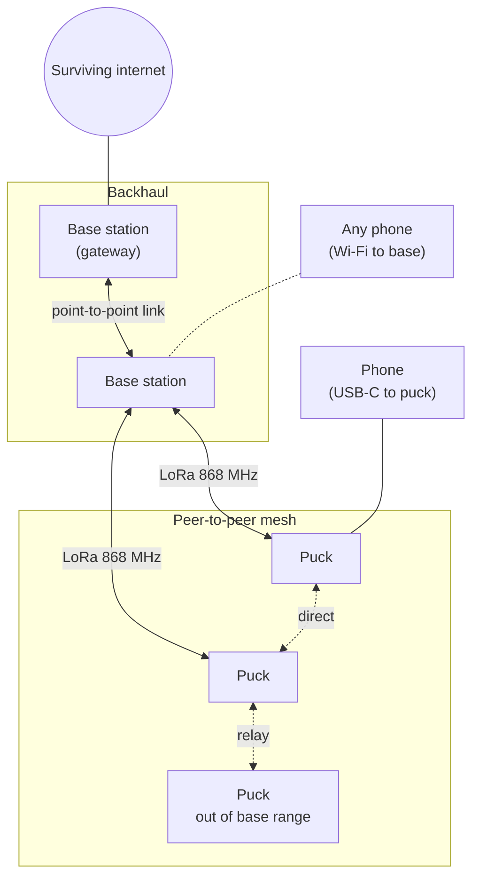

# STRATUM

**Survivable Terrestrial Relay And Tactical Unified Mesh**: a deployable, satellite-free communications network for disaster zones.


When earthquakes, floods or storms knock out cell towers and fiber, the people who need to coordinate are cut off exactly when it matters most. Satellite terminals help, but they depend on a third-party constellation, a subscription, a large power budget and a supply chain you don't control.

STRATUM gets the "relay in the sky" effect from **height on the ground** (masts) and **cooperation between nodes** (mesh networking, store-and-forward). It gives responders and affected people text messaging, position sharing, SOS alerts, and internet access whenever any backhaul survives.

> **Project status:** early development. The [system specification](STRATUM-SPEC.md) is written, and the Phase 1 radio firmware is ready for hardware bring-up. Nothing here is field-proven yet. See the [roadmap](#roadmap).

---

## How it works

Two kinds of nodes speak **one protocol**:

- **Puck**: a pocket-sized rugged radio that plugs into a phone over USB-C. Pucks talk directly to each other and relay for each other, so the network works with **zero infrastructure**.
- **Base station**: a case-sized node on a 6–10 m mast with long-range radio, a Wi-Fi access point for unmodified phones, local services (messaging, map, needs board), solar power, and optional backhaul towards wherever internet still exists.



The network adapts automatically as infrastructure appears or disappears:

| Mode | Available | What works |
|---|---|---|
| **Bare mesh** | Pucks only | Text, position, SOS, group messages, store-and-forward |
| **Infrastructure** | Pucks + base stations | Longer range, map and needs board, Wi-Fi access for anyone with a phone |
| **Connected** | At least one base with backhaul | Messaging to and from the outside world |

## Design principles

1. **Works with nothing, works better with infrastructure.** Peer-to-peer first; base stations extend range and capacity; internet is a bonus.
2. **Radios are untrusted pipes.** All authentication and encryption run on the microcontroller, above the radio chip. A compromised modem can drop or jam traffic, but never read or forge it.
3. **Delay tolerant.** Messages are stored and forwarded until delivered or expired. A person walking between two isolated groups carries traffic between them.
4. **Rugged and simple.** IP67 enclosures, MIL-STD-810H-inspired testing, two buttons, status readable from LEDs, a base station deployable by two people in under 10 minutes.
5. **Auditable.** Register-level firmware, small audited crypto libraries, minimal closed components inside the trust boundary.

## Key targets

| Metric | Target |
|---|---|
| Puck ↔ puck range (ground level, open terrain) | 2–5 km |
| Puck ↔ base station (base on 8 m mast) | 8–15 km |
| SOS delivery over ≤ 3 hops | < 60 s |
| Puck battery life, typical use | ≥ 72 h |
| Base station autonomy without sun | ≥ 36 h |
| Ingress protection | IP67 |

These are design targets. The Phase 1 range tests exist to replace them with measured numbers.

## Technology

| Layer | Choice |
|---|---|
| Puck | STM32U5 (Cortex-M33, TrustZone) + Semtech SX1262 LoRa radio |
| Radio | LoRa at 869.525 MHz, EU SRD sub-band (500 mW ERP, 10 % duty cycle), adaptive SF7–SF12 |
| Base station | Industrial Linux compute (i.MX 8M Plus), puck boards as LoRa modems, Wi-Fi AP, PtP backhaul, LiFePO4 + solar |
| Protocol | Identity-based addressing, multi-hop routing, store-and-forward with custody transfer, fragmentation |
| Security | X25519, Ed25519, XChaCha20-Poly1305, BLAKE2b (Monocypher / RustCrypto); signed firmware, revocation |
| Languages | C (firmware), Rust (base station and tools), VHDL (future SDR base station) |

## Repository layout

```
.
├── STRATUM-SPEC.md               System specification: the single source of truth
└── firmware/
    └── phase1-pingpong/          SX1262 bring-up and range-test firmware (NUCLEO-U545RE-Q + Core1262)
```

Planned as the project grows (spec §19): protocol reference implementation and test vectors, base station daemon, local web app, coordinator tool, network simulator, KiCad hardware, and FPGA gateware.

## Getting started

Phase 1 runs on off-the-shelf development boards, about €35 per node:

| Part | Qty |
|---|---|
| NUCLEO-U545RE-Q | 3 |
| Waveshare Core1262-868M (SX1262) | 3 |
| 868 MHz antenna, SMA male | 3 |
| U.FL → SMA female pigtail | 3+ |

On Linux:

```bash
cd firmware/phase1-pingpong
make deps          # fetch CMSIS headers (pinned commits)
make               # build with arm-none-eabi-gcc
make flash         # flash over the on-board ST-LINK
make term          # serial console, 115200 baud
```

The [Phase 1 README](firmware/phase1-pingpong/README.md) covers wiring, bring-up step by step, troubleshooting, and the outdoor range-test procedure.

## Roadmap

| Phase | Goal | Status |
|---|---|---|
| **P0** | Specification and toolchain | ✅ Done |
| **P1** | Two dev-board nodes talking peer-to-peer; real range data | 🔧 Firmware ready, hardware on order |
| **P2** | Mesh routing, store-and-forward, end-to-end security | ⏳ Planned |
| **P3** | Custom puck PCB, rev A | ⏳ Planned |
| **P4** | Base station v1 | ⏳ Planned |
| **P5** | Rugged puck enclosure and environmental testing | ⏳ Planned |
| **P6** | Multi-site field trials | ⏳ Planned |
| **P7** | SDR base station with a custom FPGA waveform (research) | ⏳ Planned |

Exit criteria for each phase are in the [specification](STRATUM-SPEC.md#15-roadmap).

## Regulatory note

STRATUM transmits on licence-exempt EU SRD bands. The firmware enforces power and duty-cycle limits itself. If you build it, you are responsible for complying with the radio regulations where you operate. Nothing in this repository has been certified.

## Contributing

The project is at an early stage, and the most useful contributions right now are:

- **Review of the [specification](STRATUM-SPEC.md)**, especially the protocol (§8) and security model (§9).
- **Range measurements** from your own Phase 1 boards in different terrain.
- **Experience with disaster response or field communications**: what actually matters on the ground.

Open an issue before starting larger work so we can agree on the approach. Design changes go through the decision log in the spec (§18).

## License

Not yet decided (open question O-007 in the spec). The intent is open-source software and open hardware. Until a license is added, all rights are reserved.

## Acknowledgements

- [Reticulum](https://reticulum.network/), whose identity-based, delay-tolerant design inspired the protocol
- [Monocypher](https://monocypher.org/), small audited cryptography
- Semtech and STMicroelectronics, for thorough public documentation of the SX1262 and STM32U5
