# STRATUM — System Specification

**Survivable Terrestrial Relay And Tactical Unified Mesh**

| | |
|---|---|
| Document | STRATUM system specification |
| Version | 0.1.1 — draft |
| Date | 2026-10-28 |
| Owner | CtxtArc |
| Status | Phase 0 (specification) |

> "STRATUM" is a working name (see open question O-002).
> This file is the single source of truth for the project. If something is not in here, it is not decided.

---

## 0. Summary

STRATUM is a deployable, **satellite-free** communications network for disaster zones. It gives responders and affected people text messaging, position sharing, SOS alerts and, when any backhaul is reachable, internet access, using only terrestrial radio.

It has **two kinds of nodes that speak one protocol**:

- **Puck**: a pocket-sized rugged radio (STM32U585 + Semtech SX1262 LoRa at 868 MHz) that plugs into a phone over USB-C. Pucks talk directly to each other and relay for each other (multi-hop, store-and-forward), so the network works with **zero infrastructure**.
- **Base station**: a case-sized node on a 6–10 m mast. It has long-range LoRa, a Wi-Fi access point for unmodified phones, local services (messaging, map, needs board), solar power, and an optional backhaul link towards wherever internet still exists.

**Design pillars**

1. **Works with nothing, works better with infrastructure.** Peer-to-peer first; base stations extend range and capacity; internet is a bonus.
2. **Radios are untrusted pipes.** All authentication and encryption run on the STM32, above the radio chip. A compromised modem can drop or jam traffic, never read or forge it.
3. **Delay tolerant.** Messages are stored and forwarded until delivered or expired, so a node walking between two groups carries traffic between them.
4. **Rugged and simple.** IP67, MIL-STD-810H-inspired tests, deployable by non-experts in minutes.

**Key targets**

| Metric | Target |
|---|---|
| Puck ↔ puck range (ground level, open terrain) | 2–5 km |
| Puck ↔ base station (base on 8 m mast) | 8–15 km |
| Base ↔ base backhaul (point-to-point, line of sight) | 10–30 km |
| SOS end-to-end delivery, ≤ 3 hops | < 60 s |
| Puck battery life, typical use | ≥ 72 h |
| Base station autonomy without sun | ≥ 36 h |
| Base station deployment, 2 people | ≤ 10 min |
| Ingress protection | IP67 |
| Operating temperature (puck / base) | −20…+55 °C / −30…+60 °C |

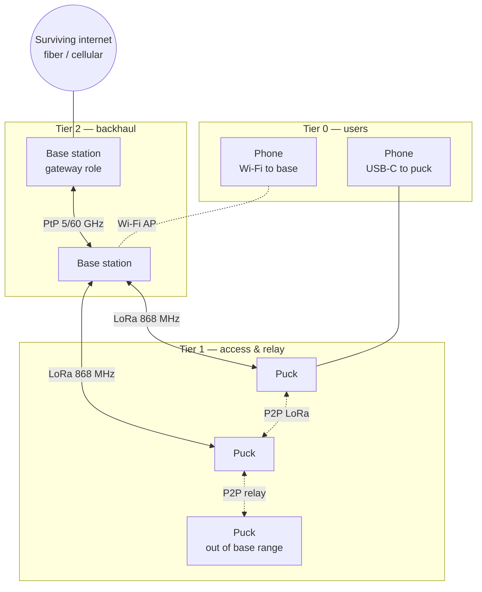

---

## Table of contents

1. [How to use this document](#1-how-to-use-this-document)
2. [Problem, goals and non-goals](#2-problem-goals-and-non-goals)
3. [Requirements](#3-requirements)
4. [System architecture](#4-system-architecture)
5. [RF design](#5-rf-design)
6. [Hardware — puck](#6-hardware--puck)
7. [Hardware — base station](#7-hardware--base-station)
8. [Protocol](#8-protocol)
9. [Security](#9-security)
10. [Software](#10-software)
11. [Ruggedization and environment](#11-ruggedization-and-environment)
12. [Usability and field operations](#12-usability-and-field-operations)
13. [Regulatory](#13-regulatory)
14. [Testing and validation](#14-testing-and-validation)
15. [Roadmap](#15-roadmap)
16. [Bill of materials (estimates)](#16-bill-of-materials-estimates)
17. [Risks](#17-risks)
18. [Decision log and open questions](#18-decision-log-and-open-questions)
19. [Repository layout and toolchain](#19-repository-layout-and-toolchain)
20. [References](#20-references)
21. [Glossary](#21-glossary)
22. [Changelog](#22-changelog)

---

## 1. How to use this document

- **Single source of truth.** Architecture, protocol, hardware, tests and plans all live here. Code and schematics implement this file; when they disagree, either the code is wrong or this file must be updated first.
- **External documents** are limited to datasheets, reference manuals and standards, all listed in [§20](#20-references).
- **Keywords**: MUST, SHOULD and MAY follow RFC 2119.
- **Identifiers**:

| Prefix | Meaning | Where |
|---|---|---|
| `REQ-xxx` | Requirement | §3 |
| `D-xxx` | Decision taken | §18 |
| `O-xxx` | Open question | §18 |
| `R-xxx` | Risk | §17 |
| `T-xxx` | Test | §14 |

- **Status tags** used inline:
  - **[DECIDED]**: fixed unless reopened through the decision log.
  - **[PROPOSED]**: default choice, not yet validated.
  - **[OPEN]**: undecided, see the linked `O-xxx`.
  - **[VERIFY]**: a number taken from memory or estimation that MUST be checked against the datasheet or regulation before it is relied on.
- **Changing this document**: bump the version, add a line to [§22](#22-changelog), and if a decision changed, update [§18](#18-decision-log-and-open-questions).

---

## 2. Problem, goals and non-goals

### 2.1 Problem

After earthquakes, floods, storms or conflict, terrestrial networks fail exactly when they are needed: cell towers lose power or backhaul, and fiber gets cut. Satellite terminals (Starlink and others) solve this but depend on a third-party constellation, a subscription, a large power budget and a supply chain the user does not control.

STRATUM gets the "relay in the sky" effect from **height on the ground** (masts) and **cooperation between nodes** (mesh, store-and-forward).

### 2.2 Goals

| ID | Goal |
|---|---|
| G1 | Text, position and SOS between people with no infrastructure at all |
| G2 | Extend range and capacity with deployable base stations |
| G3 | Give unmodified phones access through Wi-Fi at base stations |
| G4 | Bridge to the internet when any backhaul path exists |
| G5 | Secure by design: confidentiality, authenticity, resistance to injection and replay |
| G6 | Survive harsh handling and weather; usable by non-experts |
| G7 | Auditable: open firmware, documented hardware, minimal closed components inside the trust boundary |

### 2.3 Non-goals (v1)

- Replacing broadband. STRATUM v1 is a **messaging and coordination** network; base-station Wi-Fi with backhaul is best effort.
- Voice calls in real time over LoRa. Short voice clips are a possible v2 feature (O-008).
- Satellite links of any kind.
- HF radio. It needs an amateur license; listed as a future extension only.
- Certification for market sale. Prototypes are built for development and field trials; certification is planned but not part of v1 exit criteria.
- Resistance to a well-funded physical attacker who extracts keys from a captured device (mitigated by revocation, not prevented).

### 2.4 Users and use cases

| ID | Actor | Use case |
|---|---|---|
| UC-1 | Rescuer in the field | Sends text and position to the coordination post, with no base station in range |
| UC-2 | Coordinator | Sees all puck positions and messages on a map at the base station |
| UC-3 | Affected civilian | Joins base-station Wi-Fi with their own phone, registers as safe or posts a need, with no app install |
| UC-4 | Anyone | Triggers SOS; it propagates to every node in range and is relayed to the coordinator |
| UC-5 | Team | Walks out of coverage; messages queue and deliver automatically when back in range or when another puck passes by |
| UC-6 | Coordinator | Reaches the outside world (email/messaging) through a gateway base station when backhaul exists |
| UC-7 | Coordinator | Provisions new pucks, and revokes a lost or captured puck |

---

## 3. Requirements

Priority: **M** = must for v1, **S** = should, **C** = could (later).

### 3.1 Functional

| ID | Requirement | Pri |
|---|---|---|
| REQ-001 | Two pucks MUST exchange text messages directly without any other equipment. | M |
| REQ-002 | Pucks MUST relay traffic for other pucks (multi-hop, ≥ 4 hops). | M |
| REQ-003 | A node MUST store messages it cannot deliver and forward them when a route appears (store-and-forward). | M |
| REQ-004 | Pucks MUST share GNSS position on request and periodically (configurable, default 5 min). | M |
| REQ-005 | SOS MUST be triggerable from the puck alone, without the phone. | M |
| REQ-006 | SOS MUST be flooded to all reachable nodes and acknowledged by any base station. | M |
| REQ-007 | A base station MUST bridge LoRa traffic to phones on its Wi-Fi via a local web app with no install. | M |
| REQ-008 | Base stations MUST route traffic to each other over backhaul links when available. | S |
| REQ-009 | A gateway base station SHOULD relay messages to and from the internet (e.g. email bridge). | S |
| REQ-010 | Messages MUST carry delivery receipts (end-to-end ACK). | M |
| REQ-011 | Group messages (one-to-all within a deployment) MUST be supported. | M |
| REQ-012 | The coordinator MUST be able to provision and revoke pucks. | M |
| REQ-013 | Short voice clips (Codec2) MAY be supported. | C |
| REQ-014 | A puck MUST work as the LoRa modem of a base station (same board, same firmware, modem mode). | M |

### 3.2 Performance

| ID | Requirement | Pri |
|---|---|---|
| REQ-020 | Puck ↔ puck range ≥ 2 km in open terrain at ground level (1.5 m). | M |
| REQ-021 | Puck ↔ base range ≥ 8 km with base antenna at 8 m, open terrain. | M |
| REQ-022 | SOS delivery to a base station within 60 s over ≤ 3 hops, ≥ 95 % of attempts in field test. | M |
| REQ-023 | Text message delivery within 30 s over ≤ 3 hops when routes exist, ≥ 90 % of attempts. | M |
| REQ-024 | A base station MUST support ≥ 200 pucks and ≥ 50 Wi-Fi clients. | S |
| REQ-025 | Puck battery life ≥ 72 h with continuous receive, 20 sent messages/h, position every 5 min. | M |
| REQ-026 | Base station autonomy ≥ 36 h at nominal load without solar input. | M |
| REQ-027 | Puck boot to operational ≤ 5 s. | S |

### 3.3 Security

| ID | Requirement | Pri |
|---|---|---|
| REQ-040 | All user payloads MUST be end-to-end encrypted and authenticated. | M |
| REQ-041 | Frames from devices outside the deployment MUST be rejected at link level. | M |
| REQ-042 | Replayed frames MUST be detected and dropped. | M |
| REQ-043 | Keys MUST NOT leave the STM32 secure world (TrustZone). | M |
| REQ-044 | Firmware MUST be signed; nodes MUST refuse unsigned or downgraded images. | M |
| REQ-045 | Revoked nodes MUST be excluded network-wide within 10 min of revocation reaching a base station. | S |
| REQ-046 | No radio chip, GNSS module or Wi-Fi module may hold or see a key. | M |
| REQ-047 | Debug ports MUST be locked on fielded units. | M |

### 3.4 Environmental and mechanical

| ID | Requirement | Pri |
|---|---|---|
| REQ-060 | Puck and base enclosures MUST meet IP67. | M |
| REQ-061 | Puck MUST survive 26 drops from 1.5 m onto concrete (all faces, edges, corners). | M |
| REQ-062 | Operating temperature: puck −20…+55 °C, base −30…+60 °C. | M |
| REQ-063 | Storage temperature −40…+70 °C (batteries at storage charge). | S |
| REQ-064 | Vibration per MIL-STD-810H Method 514.8 (ground vehicle transport profile). | S |
| REQ-065 | Base mast installation MUST withstand 80 km/h wind with guy lines. | S |
| REQ-066 | Batteries MUST NOT charge outside their safe temperature window. | M |

### 3.5 Usability

| ID | Requirement | Pri |
|---|---|---|
| REQ-080 | Puck operation MUST be possible with gloves (2 buttons, no touchscreen required). | M |
| REQ-081 | Node status MUST be readable from LEDs alone. | M |
| REQ-082 | A base station MUST be deployable by 2 people in ≤ 10 min with a printed checklist and no laptop. | M |
| REQ-083 | Civilians MUST be able to use base-station Wi-Fi services from a standard browser. | M |
| REQ-084 | Every unit MUST carry a printed quick-start label. | S |

### 3.6 Regulatory

| ID | Requirement | Pri |
|---|---|---|
| REQ-100 | Transmissions MUST respect EU SRD rules (power, duty cycle) for each sub-band used — see §5.2. | M |
| REQ-101 | Firmware MUST enforce duty-cycle limits itself (cannot be disabled in user firmware). | M |
| REQ-102 | Design SHOULD target RED 2014/53/EU compliance for future certification. | S |

---

## 4. System architecture

### 4.1 Node types

| Node | What it is | Radios | Power |
|---|---|---|---|
| **Puck** | Handheld radio, pairs with a phone over USB-C | LoRa 868 MHz, GNSS (rx only) | 1× 21700 Li-ion |
| **Base station** | Mast-mounted case: relay, local services, Wi-Fi AP | 1–2 LoRa modems (pucks in modem mode), Wi-Fi AP, backhaul port | LiFePO4 + solar |
| **Gateway** | A base station that also has an internet uplink (role, not a separate device) | Same + uplink (Ethernet, PtP, cellular if alive) | Same |
| **Coordinator tool** | CLI/web tool on a laptop that holds the deployment authority key | USB to puck | Laptop |

### 4.2 Operating modes

The network moves between three modes automatically, with no configuration:

| Mode | Available | What works |
|---|---|---|
| **A — Bare mesh** | Pucks only | Text, position, SOS, group messages, store-and-forward |
| **B — Infrastructure** | Pucks + base stations | Everything in A, with longer range, map and needs board, Wi-Fi access for civilians |
| **C — Connected** | B + at least one gateway | Everything in B, plus outside-world messaging |

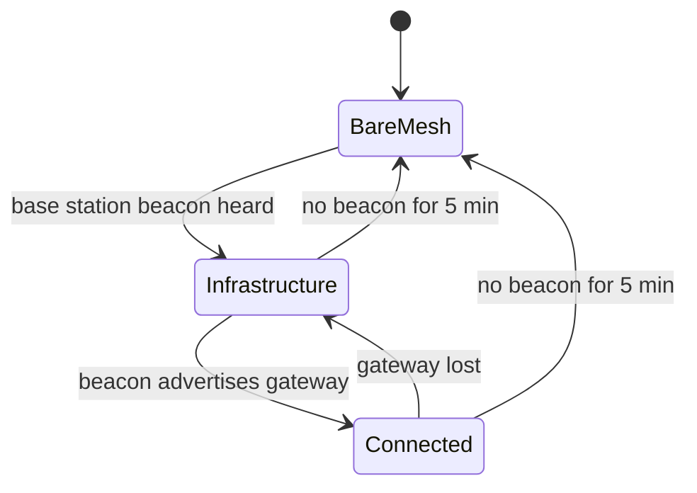

### 4.3 Graceful degradation

| Failure | Effect | What still works |
|---|---|---|
| Internet uplink lost | Mode C → B | All local services; outbound messages queue at the gateway |
| Base station Linux crashes | Supervisor MCU keeps LoRa modem relaying | Puck relay and SOS through that base (no Wi-Fi, no web app) |
| Base station destroyed | Mode B → A for its area | Pucks fall back to P2P; queued messages wait in pucks |
| Phone lost or dead | Puck works standalone | SOS, position beacon, relay for others |
| GNSS jammed or unavailable | No position | Messaging; last known position is flagged as stale |
| One LoRa channel jammed | Switch to secondary channel plan (§5.2) | Reduced capacity |

### 4.4 Example data flow — message from puck to civilian phone

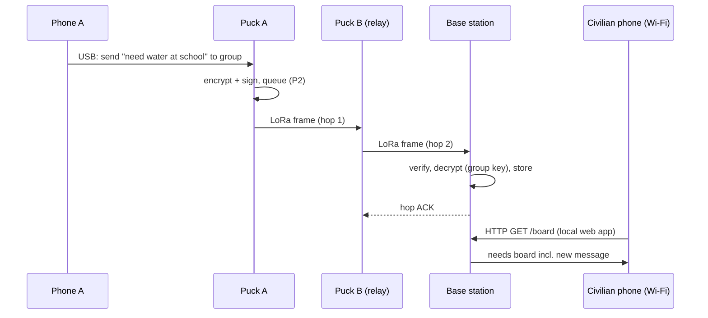

---

## 5. RF design

### 5.1 Why height matters

Range on the ground is limited by the radio horizon and by obstacles, not by power. Radio horizon with standard refraction (k = 4/3):

`d_km ≈ 4.12 × √h_m`; the maximum line-of-sight path between two antennas is `d = 4.12 × (√h1 + √h2)`.

| Antenna A | Antenna B | Max LOS distance |
|---|---|---|
| 1.5 m (puck on body) | 1.5 m | ~10 km |
| 1.5 m | 8 m (base mast) | ~16.7 km |
| 8 m | 8 m | ~23 km |
| 10 m | 10 m | ~26 km |
| 100 m (tethered drone, future) | 1.5 m | ~46 km |

In practice, terrain, vegetation, buildings and the Fresnel zone cut this down considerably; the targets in §0 already include that margin. **Masts are the cheapest way to add range.**

### 5.2 Bands and channel plan

EU SRD rules in the 863–870 MHz band come from ERC Recommendation 70-03, Annex 1, and ETSI EN 300 220. **[VERIFY]** All values below MUST be checked against the current edition before field use.

| Sub-band | Frequency (MHz) | Max power | Duty cycle | STRATUM use |
|---|---|---|---|---|
| h1.4 / "g1" | 868.000–868.600 | 25 mW ERP | 1 % | **CH-B**: secondary / overflow (868.1, 868.3, 868.5) |
| h1.5 / "g2" | 868.700–869.200 | 25 mW ERP | 0.1 % | not used |
| h1.6 / "g3" | 869.400–869.650 | 500 mW ERP | 10 % | **CH-A**: primary mesh channel, 869.525 MHz |
| h1.7 / "g4" | 869.700–870.000 | 25 mW ERP | 1 % | **CH-C**: local base ↔ puck low power (optional) |

**[DECIDED] D-007** Primary channel CH-A = 869.525 MHz, BW 125 kHz. It is the only EU sub-band with both 500 mW and 10 % duty cycle, so it carries the mesh.

**Other links**

| Link | Band | Rules | Notes |
|---|---|---|---|
| Base Wi-Fi AP | 2.4 GHz (+ 5 GHz optional) | EN 300 328 / EN 301 893 | Standard 802.11 for phones |
| Backhaul PtP | 5 GHz | EN 301 893, DFS required | COTS radios, 10–30 km LOS |
| Backhaul PtP short | 60 GHz (57–71 GHz) | EN 302 567 | ≤ 1–2 km, very high throughput, rain-sensitive |
| SDR base v2 | 868 MHz and/or 2.4 GHz | EN 300 220 / EN 300 328 (FHSS rules) | §7.4 |
| HF NVIS (future) | 3–10 MHz amateur bands | Amateur license (HAREC) | Out of scope v1 |

### 5.3 LoRa parameters and airtime

Time on air (Semtech AN1200.13), for one LoRa packet:

```
T_sym      = 2^SF / BW
n_payload  = 8 + max( ceil( (8·PL − 4·SF + 28 + 16·CRC − 20·IH) / (4·(SF − 2·DE)) ) · (CR + 4), 0 )
T_preamble = (n_preamble + 4.25) · T_sym
ToA        = T_preamble + n_payload · T_sym
```

`PL` payload bytes, `CRC` = 1, `IH` = 0 (explicit header), `CR` = 1 (4/5), `DE` = 1 when `T_sym` > 16 ms (SF11/12 at 125 kHz), `n_preamble` = 8.

Airtime of a 100-byte frame at BW 125 kHz, CR 4/5 (computed with the formula above):

| SF | Bit rate (approx.) | ToA 100 B | Sensitivity SX1262 [VERIFY] | Use |
|---|---|---|---|---|
| 7 | 5.5 kbps | ~0.17 s | ≈ −124 dBm | Short links, base ↔ nearby pucks |
| 9 | 1.8 kbps | ~0.55 s | ≈ −129 dBm | **Default** |
| 12 | 0.29 kbps | ~3.9 s | ≈ −137 dBm | Last resort, SOS only |

**[PROPOSED]** Adaptive data rate per link: each node picks the lowest SF with ≥ 6 dB SNR margin to that neighbor (§8.6). Broadcasts (beacons, announces, floods) use the SF needed by the weakest known neighbor, capped at SF10, except SOS, which may use SF12.

### 5.4 Duty-cycle budget

The duty cycle is counted per node, per sub-band, over a sliding 1-hour window.

| Channel | Duty | Airtime / hour | Frames/h at SF9, 100 B |
|---|---|---|---|
| CH-A | 10 % | 360 s | ~650 |
| CH-B | 1 % | 36 s | ~65 |

Allocation of each node's CH-A budget **[PROPOSED]**:

| Class | Share | Content |
|---|---|---|
| Reserved P0/P1 | 20 % | SOS, priority traffic — never consumed by lower classes |
| Control | 15 % | Beacons, announces, routing |
| Data | 65 % | User traffic and relaying |

When a node's budget runs out, it queues traffic (store-and-forward) rather than dropping it. Base stations relay most of the traffic and are the first to hit the limit, so base stations SHOULD run two modems (CH-A + CH-B) to double their budget.

### 5.5 Link budgets

Free-space path loss: `FSPL(dB) = 20·log10(d_km) + 20·log10(f_MHz) + 32.44`. At 869.5 MHz this is 91.2 dB at 1 km, 105.2 dB at 5 km, 111.2 dB at 10 km and 117.2 dB at 20 km.

| Link | Tx power | Tx ant. | Rx ant. | Rx sens. (SF9) | Budget | − 20 dB fade margin | Allowed path loss |
|---|---|---|---|---|---|---|---|
| Puck → puck | +22 dBm | −5 dBi (body) | −5 dBi | −129 dBm | 141 dB | | **121 dB** |
| Base → puck | +22 dBm | +6 dBi − 1 dB cable | −5 dBi | −129 dBm | 151 dB | | **131 dB** |
| Puck → base | +22 dBm | −5 dBi | +6 dBi − 1 dB | −129 dBm | 151 dB | | **131 dB** |

Check: base EIRP = 22 + 6 − 1 = 27 dBm. The CH-A limit of 500 mW ERP equals 27 dBm ERP ≈ 29.15 dBm EIRP, so this is compliant with ~2 dB margin.

At ground level, path loss grows much faster than free space (two-ray and clutter effects). Use a propagation model for planning (§5.7); the range targets in §0 are conservative estimates.

### 5.6 Antennas

| Node | Antenna | Gain | Connector |
|---|---|---|---|
| Puck | Flexible 868 MHz whip, ~λ/4 with ground plane or sleeve dipole | ~0–2 dBi (−5 dBi effective on body) | SMA (rev A), TNC (rugged rev) |
| Base, LoRa | Fiberglass collinear 868 MHz, vertical | 6 dBi | N-type |
| Base, Wi-Fi AP | Omni 2.4/5 GHz | 5–8 dBi | N-type |
| Base, backhaul | Integrated in COTS PtP radio (dish or panel) | 20–30 dBi | — |

Mast cable: low-loss coax (LMR-400 class), ≤ 10 m, ~1 dB at 868 MHz [VERIFY]. A lightning arrester (gas discharge) MUST sit at the case bulkhead, with the mast grounded.

### 5.7 Coverage planning

- Tool: **SPLAT!** (open source, Longley-Rice / ITM) with SRTM terrain data, run on the coordinator laptop before deployment.
- Output: a coverage map per base station location, and a list of recommended mast sites.
- Rule of thumb for siting: high ground, clear of obstructions within the first Fresnel zone, ≤ 15 km between base stations for overlapping coverage.

---

## 6. Hardware — puck

### 6.1 Architecture

**[DECIDED] D-003**: STM32U585 (trusted host) + Semtech SX1262 (radio modem) over SPI.

Why not the STM32WL? The WL integrates the radio but has **no USB peripheral**, which the phone link needs. Splitting host and modem also keeps a hard boundary: the SX1262 is a fixed-function modem that only ever sees ciphertext.

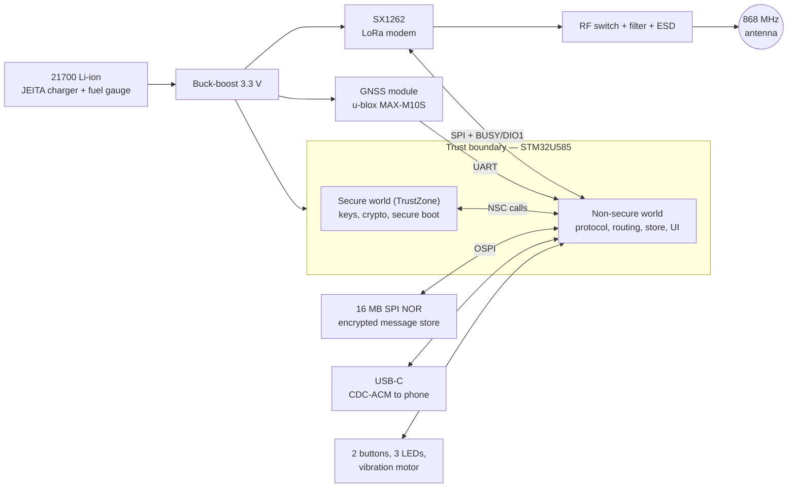

### 6.2 Components

| Function | Part [PROPOSED] | Notes |
|---|---|---|
| MCU | STM32U585 (Cortex-M33, 160 MHz, 2 MB flash, 786 KB SRAM) | TrustZone, AES/SAES, PKA, HASH, TRNG, USB OTG FS, OCTOSPI [VERIFY exact package] |
| LoRa radio | Semtech SX1262 | +22 dBm PA, 150–960 MHz, 32 MHz TCXO required for SF ≥ 11 stability |
| RF front-end | SPDT RF switch, 868 MHz SAW or LC filter, TVS/ESD on the antenna port | Harmonic filtering per EN 300 220 |
| GNSS | u-blox MAX-M10S (GPS/Galileo/GLONASS/BeiDou) | Closed firmware: **untrusted**, position data only; backup supercap for hot start |
| Storage | 16 MB SPI/OSPI NOR flash | littlefs; contents encrypted with a device key |
| Battery | 1× 21700 Li-ion, 4000–5000 mAh | Charging blocked < 0 °C and > 45 °C |
| Charger | TI BQ2561x-class, JEITA, NTC input | USB-C 5 V sink only (CC pull-downs, no PD) |
| Fuel gauge | Analog Devices MAX17048 | I²C |
| Regulator | TI TPS63802 buck-boost, 3.3 V | Efficient across the whole 2.8–4.2 V battery range |
| USB-C | Receptacle with ESD array (TPD4E05-class) | Device mode, CDC-ACM |
| UI | 1 guarded SOS button, 1 multifunction button, 3 LEDs (RGB-capable), vibration motor | Glove-friendly |
| Debug | Tag-Connect TC2030 SWD footprint | Locked in production (§9.8) |

### 6.3 Power budget

Currents are datasheet-typical values **[VERIFY]**.

| State | Current | Duty (typical use) | Average |
|---|---|---|---|
| SX1262 RX (DC-DC on) | ~4.6 mA | 100 % (continuous listen) | 4.6 mA |
| SX1262 TX +22 dBm | ~118 mA | ~1 % (relaying included) | 1.2 mA |
| MCU active 160 MHz | ~15 mA | 5 % | 0.8 mA |
| MCU stop mode | ~0.01 mA | 95 % | ~0 mA |
| GNSS (power-save, fix every 5 min) | ~8 mA tracking | 10 % | 0.8 mA |
| LEDs, misc, regulator losses | | | ~1.5 mA |
| **Total** | | | **~9 mA** |

4500 mAh / 9 mA ≈ 500 h theoretical. Even with heavy relaying (TX at 5 %) and −20 °C capacity loss (~40 %), the 72 h target (REQ-025) holds with a wide margin. **[PROPOSED]** Continuous receive (no duty-cycled RX) in v1 keeps the routing simple; duty-cycled listening is a v2 optimisation.

### 6.4 Mechanical

- Size target ≤ 110 × 65 × 30 mm, weight ≤ 250 g with battery.
- Enclosure: glass-fiber-reinforced PA66 or polycarbonate shell, TPE overmold bumpers, O-ring gasket.
- Battery door with a captive screw (tool-less for field swap); battery holder with sprung contacts rated for shock.
- ePTFE pressure-equalisation vent (Gore-type) to prevent seal pumping with altitude and temperature.
- PCB: conformal coating (IPC-CC-830, acrylic or urethane), connectors and the SWD pad masked.
- Antenna: bulkhead connector with O-ring; antenna swappable without opening the case.
- Mounting: MOLLE/PALS clip and lanyard point.
- Prototype path: rev A in a COTS IP67 box (Hammond 1554-class) → rev B in a custom enclosure (3D-printed for fit, then machined or molded).

---

## 7. Hardware — base station

### 7.1 Base station v1 architecture

The base station reuses the **puck board in modem mode** as its LoRa radio (REQ-014). An independent **supervisor MCU** keeps the essentials alive if the Linux computer fails.

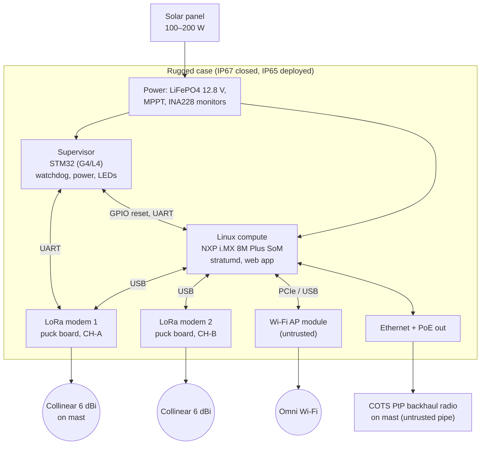

**Degraded mode (Linux down):** the supervisor detects a missed heartbeat, power-cycles the SoM, and meanwhile tells modem 1 to run in **standalone relay mode**. In that mode the puck firmware relays and stores like a normal puck, so SOS and messaging keep flowing.

### 7.2 Components

| Function | Part [PROPOSED] | Notes |
|---|---|---|
| Compute | NXP i.MX 8M Plus industrial SoM (−40…+85 °C) | Mainline Linux, well-documented; Buildroot image |
| Supervisor | STM32G4 or STM32L4 | Owns power sequencing, watchdog, LED panel, battery telemetry |
| LoRa modems | 2× puck board (no battery, no GNSS fitted) | USB to SoM, UART to supervisor |
| Wi-Fi AP | 802.11ac/ax module with mainline Linux driver | Closed firmware → outside the trust boundary |
| Backhaul | COTS 5 GHz PtP pair (MikroTik / Ubiquiti class) over Ethernet + PoE | Untrusted; all traffic inside WireGuard |
| Storage | Industrial eMMC 32 GB | Message store, maps, logs |
| GNSS | Same module as the puck | Base position and time |
| Battery | LiFePO4 12.8 V, 50 Ah (640 Wh) with BMS | Self-heating pad for charging < 0 °C |
| Solar | 100–200 W folding panel + MPPT controller | |
| Power monitoring | TI INA228 on each rail | Reported to the coordinator |
| Case | Pelican-type hard case, ~50 × 40 × 20 cm | Bulkhead N-type, PoE and power connectors |
| Mast | 6–10 m telescopic fiberglass, guy kit, ground stake | Lightning arrester at the case |

### 7.3 Base station power budget

| Load | Power [VERIFY] |
|---|---|
| i.MX 8M Plus SoM, nominal | 4 W |
| Wi-Fi AP, active | 3 W |
| 2× LoRa modems | 0.5 W |
| PtP backhaul radio (PoE) | 6 W |
| Supervisor, LEDs, conversion losses | 1.5 W |
| **Total nominal** | **~15 W** |

640 Wh × 0.85 usable ÷ 15 W ≈ **36 h** without sun, which meets REQ-026. Without backhaul, the load drops to ~9 W and autonomy rises to ~60 h. A 200 W panel at an average 4 peak-sun-hours yields ~800 Wh/day, enough for indefinite operation in good conditions.

### 7.4 Base station v2 — SDR (research phase)

The goal is a custom waveform for long-range, jam-resistant backhaul and base ↔ base links, implemented in FPGA. **[OPEN] O-004** selects the platform.

| Option | Platform | Pros | Cons |
|---|---|---|---|
| A | Xilinx Zynq-7020 + ADI AD9363 (2×2, 325 MHz–3.8 GHz, 20 MHz BW) | Proven (Pluto/LibreSDR-style), ARM + Linux on chip, wide bandwidth | Proprietary toolchain (Vivado); larger power budget |
| B | Lattice ECP5-85 + Microchip AT86RF215 (sub-GHz + 2.4 GHz I/Q over LVDS) | Fully open toolchain (Yosys/nextpnr/GHDL plugin); low power; cheap | Narrower bandwidth; separate host CPU needed |

Waveform research items (VHDL):

- **FHSS** with a keyed hop sequence (key from the deployment, §9.4); must respect EN 300 328 FHSS rules at 2.4 GHz.
- **DSSS / chirp spreading** for low probability of detection and interception, and jam margin.
- **Adaptive modulation and coding**, from robust (BPSK, heavy FEC) to fast (QAM).
- **Receive diversity** (2 antennas, maximum-ratio combining).

The SDR link is a transport only: STRATUM frames (§8) ride on it unchanged, so the protocol does not depend on the PHY.

---

## 8. Protocol

### 8.1 Stack

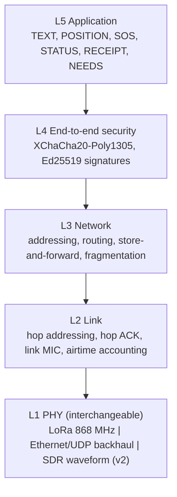

**[DECIDED] D-004**: STRATUM uses its own protocol, inspired by Reticulum (identity-based addressing, delay tolerance). Reticulum's reference implementation is Python and does not run on the puck; owning the stack also keeps the whole design auditable.

**Byte order**: little-endian for all multi-byte integers (native to Cortex-M and x86/ARM64).

### 8.2 Identities and addressing

- Each node has two key pairs, generated inside the secure world at provisioning time:
  - **Ed25519** for signing (identity);
  - **X25519** for key agreement.
- **Node address** (64 bit) = first 8 bytes of `BLAKE2b-256(Ed25519_public_key)`. It is used end to end (L3) and is stable for the node's lifetime.
- **Link short address** (32 bit) = first 4 bytes of the node address. It is used only hop by hop (L2); a collision between two neighbors is detected by the announce/beacon logic, and the neighbor table then falls back to the full address.
- **Broadcast**: L2 `0xFFFFFFFF`, L3 `0xFFFFFFFFFFFFFFFF`.
- **Group address**: `BLAKE2b-256("group" ‖ net_id ‖ group_name)`, first 8 bytes. Group 0 ("all") is the whole deployment.

A 64-bit address space reaches a 50 % collision probability only around 4 billion nodes, so collisions are negligible at deployment scale.

### 8.3 L2 link frame

Maximum LoRa payload is 255 bytes.

| Offset | Size | Field | Description |
|---|---|---|---|
| 0 | 1 | `FCTL` | bits 7–6 version (= 0), bits 5–3 frame type, bit 2 ACK request, bit 1 more-fragments-follow-at-L2 (reserved, 0), bit 0 reserved |
| 1 | 2 | `NET_ID` | Deployment identifier (from provisioning) |
| 3 | 4 | `TX` | Short address of this transmitter |
| 7 | 4 | `RX` | Short address of the next hop, or broadcast |
| 11 | 2 | `LSEQ` | Link sequence number, per transmitter (for hop ACK and dedup) |
| 13 | n | `PAYLOAD` | L3 packet or link-control body |
| 13+n | 4 | `LMIC` | `BLAKE2b-keyed(link_key, bytes[0 .. 13+n))` truncated to 4 bytes |

**L2 overhead: 17 bytes.**

L2 frame types (`FCTL` bits 5–3):

| Value | Type | Body |
|---|---|---|
| 0 | `DATA` | L3 packet |
| 1 | `HACK` | Hop ACK: acknowledged `LSEQ` (2 B) + RSSI (1 B) + SNR (1 B) as measured by the receiver |
| 2 | `BEACON` | Base station beacon (§8.6) |
| 3 | `ANNOUNCE` | Node announce (§8.4) |
| 4–7 | reserved | |

The `LMIC` is a cheap filter that rejects outsiders before any expensive work (REQ-041). It is not the real security: end-to-end authentication at L4 is.

### 8.4 Announce

Each node broadcasts an `ANNOUNCE` at boot, then every 30 min, and on request. Receivers use it to learn public keys and certificates.

| Size | Field |
|---|---|
| 32 | Ed25519 public key |
| 32 | X25519 public key |
| 1 | Role (0 puck, 1 base, 2 gateway, 3 coordinator) |
| 4 | Certificate expiry (Unix time, u32) |
| 64 | Certificate signature by the deployment authority key (§9.4) |
| 0–16 | Callsign / display name (UTF-8) |

Size: 133–149 bytes plus L2 overhead, which fits in one frame. Nodes cache announces (≥ 1000 entries on a puck, unbounded on a base) and forward them at most once (flood with dedup, TTL 6).

### 8.5 L3 network packet

| Offset | Size | Field | Description |
|---|---|---|---|
| 0 | 1 | `NCTL` | bits 7–4 TTL (hops left, max 15), bits 3–2 priority (0 = P0 … 3 = P3), bit 1 fragment, bit 0 custody requested |
| 1 | 1 | `PTYPE` | Packet type (table below) |
| 2 | 8 | `SRC` | Source node address |
| 10 | 8 | `DST` | Destination node or group address |
| 18 | 4 | `MSG_ID` | Per-source monotonic counter (persisted, never reused) |
| 22 | 2 | `EXPIRY` | Lifetime in minutes from creation (0 = do not store) |
| 24 | (2) | `FRAG` | Present only if the fragment bit is set: index (4 bit) + total (4 bit) + reserved (8 bit) |
| 24/26 | n | `BODY` | L4 sealed payload, or routing body |

**L3 overhead: 24 bytes (26 when fragmented).** L4 adds a 16-byte tag. The maximum application payload per frame is therefore `255 − 17 − 24 − 16 = 198` bytes unfragmented.

Packet types (`PTYPE`):

| Value | Type | Sealed (L4) | Notes |
|---|---|---|---|
| 0x01 | `MSG` | yes | Application message (§8.10) |
| 0x02 | `RECEIPT` | yes | End-to-end delivery receipt for `MSG_ID` |
| 0x10 | `RREQ` | no (signed) | Route request |
| 0x11 | `RREP` | no (signed) | Route reply |
| 0x12 | `RERR` | no (signed) | Route error |
| 0x20 | `CUSTODY` | no | Custody accept/transfer (§8.8) |
| 0x30 | `REVOKE` | no (signed by DAK) | Revocation list update (§9.7) |

### 8.6 Neighbors and link quality

- Each node keeps a **neighbor table** with: short address, node address, last heard, RSSI/SNR (EWMA), bidirectional flag, ETX, best SF.
- A link is **bidirectional** only once a hop ACK or beacon proves that the other side hears us. Unidirectional links MUST NOT be used for routing, since power asymmetry between bases and pucks makes them common.
- **ETX** = 1 / (forward delivery ratio × reverse delivery ratio), computed over the last 16 attempts.
- **Base stations** send a `BEACON` every 60 s on CH-A at SF9 (≈ 0.3 % of their airtime):

| Size | Field |
|---|---|
| 8 | Base node address |
| 1 | Flags: gateway available, store has room, CH-B active |
| 1 | Hops to the nearest gateway (0xFF = none) |
| 2 | Path cost to the gateway (sum of ETX × 16) |
| 2 | Free store capacity (in messages, saturating) |
| 4 | Unix time (seconds; base stations with GNSS are the time source) |
| 64 | Ed25519 signature of the fields above + `NET_ID` |

### 8.7 Routing

Routing combines three mechanisms. Which one is used depends on what the node knows.

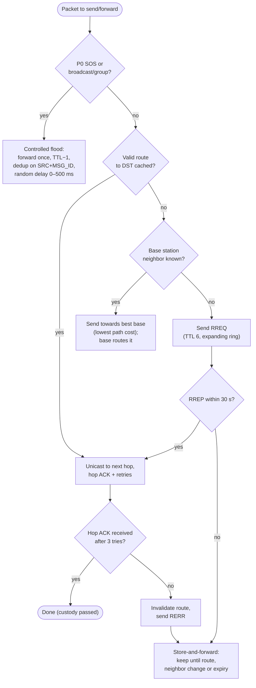

- **Gradient towards infrastructure.** Base station beacons give every puck a cost to the nearest base. Traffic for unknown destinations climbs this gradient, because bases hold the most complete route and announce tables. Bases share their tables with each other over backhaul.
- **Reactive routes (AODV-like)** for puck ↔ puck traffic without a base. `RREQ` is flooded with an expanding ring (TTL 2, then 4, then 6). The destination, or a node with a fresh route, answers with `RREP` along the reverse path. Routes expire after 10 min without use.
- **Controlled flooding** for SOS, group messages, announces and revocations. Each node forwards a packet at most once (dedup cache of `SRC`+`MSG_ID`, 4096 entries, 1 h). Forwarding is skipped if the same packet has already been heard from ≥ 3 neighbors (counter-based suppression).
- **Retries**: hop-level, 3 attempts with exponential backoff (1, 2, 4 s ± 50 % jitter).
- **Channel access**: listen before talk using SX1262 Channel Activity Detection (CAD). If the channel is busy, back off randomly for 100–1000 ms.

### 8.8 Store-and-forward and custody

- Any node accepting a packet with the custody bit set becomes its **custodian**: it keeps it until it obtains a hop ACK from the next custodian, the end-to-end receipt arrives, or `EXPIRY` passes.
- Default expiry: P0 72 h, P1 24 h, P2 24 h, P3 6 h.
- When storage is full, packets are evicted by lowest priority, then oldest; P0 is never evicted.
- **Contact trigger**: when a new neighbor appears (or one comes back), the node walks its store and tries every packet whose route now improves. This is how a walking puck carries messages between isolated groups (UC-5).
- Puck store: 16 MB NOR → ~50 000 messages. Base store: eMMC, effectively unlimited.

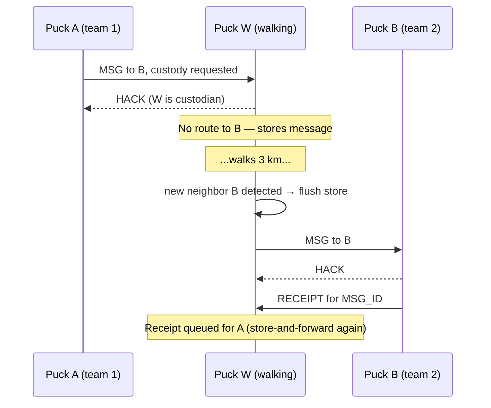

### 8.9 Fragmentation

- Payloads larger than 198 bytes are split into up to **16 fragments** (≈ 3 KB maximum per message).
- Each fragment is a separate L3 packet sharing `MSG_ID`, with `FRAG` set. L4 sealing applies to the **whole message** before fragmentation, so fragments are never decrypted individually.
- The receiver reassembles with a 10 min timeout and requests missing fragments with a selective NACK (fragment bitmap) in a `CUSTODY` packet.
- Content larger than 3 KB (photos, files) is only allowed over Wi-Fi and backhaul links, never over LoRa.

### 8.10 Application messages

The `MSG` body after decryption is a small TLV structure: `type (1 B) | length (1 B) | value`, repeated. **[OPEN] O-006** asks whether CBOR should replace this.

| Type | Name | Value |
|---|---|---|
| 0x01 | `TEXT` | UTF-8 text |
| 0x02 | `POSITION` | lat (i32, 1e-7 deg), lon (i32, 1e-7 deg), alt (i16, m), accuracy (u16, m), fix time (u32 Unix) |
| 0x03 | `SOS` | Reason code (u8: 0 generic, 1 medical, 2 trapped, 3 fire, 4 violence), people count (u8) + a mandatory `POSITION` TLV |
| 0x04 | `STATUS` | Battery % (u8), people OK (u8), needs bitmap (u16: water, food, medical, shelter, power, evacuation, …) |
| 0x05 | `REPLY_TO` | `SRC` (8) + `MSG_ID` (4) of the message answered |
| 0x06 | `TIMESTAMP` | Creation time (u32 Unix) |
| 0x07 | `VOICE` | Codec2 1200 bps frames (v2, O-008) |
| 0x80–0xFF | vendor / experimental | |

SOS behavior: holding the guarded SOS button for 3 s sends `SOS` + `POSITION` as P0, flooded with TTL 15. It repeats every 60 s while active (subject to the reserved budget), and at SF12 if no base or neighbor acknowledges after 3 attempts. Any base station that receives it MUST answer with a `RECEIPT` flooded back, and raise an alarm on its web app and LED panel.

### 8.11 Timing and synchronisation

- Time comes from GNSS (puck or base), otherwise from the base station beacon, otherwise from the phone at USB connection.
- Nodes accept a beacon time only if it is signed by a known base and within ±24 h of their own clock, or if they have no clock at all.
- No slotted MAC in v1. Time is used for expiry, certificate validation and display only.

### 8.12 Host interface (puck ↔ phone/base, "HCP")

- Transport: USB CDC-ACM serial; frames encoded with **COBS** and terminated by `0x00`, CRC-16/CCITT at the end.
- Frame: `cmd (1) | seq (2) | len (2) | body | crc (2)`.

| Cmd | Direction | Purpose |
|---|---|---|
| 0x01 `HELLO` | host → puck | Version handshake; puck replies with node address, role, firmware version |
| 0x02 `SEND` | host → puck | Send application TLVs to a destination with a priority |
| 0x03 `RECV` | puck → host | Delivered message (decrypted) |
| 0x04 `RECEIPT` | puck → host | Delivery receipt for a sent message |
| 0x05 `STATUS` | both | Battery, neighbors, mode (A/B/C), duty budget left |
| 0x06 `CONTACTS` | host → puck | List of known nodes (from announces) |
| 0x10 `MODEM` | base → puck | Switch to modem mode: raw L3 packets in/out, puck still applies L2 and duty cycle |
| 0x20 `PROVISION` | coordinator → puck | Provisioning commands (§9.5); only accepted in unprovisioned state or with a DAK-signed command |
| 0x30 `DFU` | host → puck | Firmware update chunks (signed image, §9.8) |

The phone never sees keys. In **modem mode** the host is a base station that holds its own identity and keys in its own secure storage; the modem puck only handles L2, the radio and duty cycle.

---

## 9. Security

### 9.1 Threat model

| Threat | Example | Mitigation | Residual risk |
|---|---|---|---|
| Eavesdropping | Anyone with an SDR listening on 868 MHz | End-to-end AEAD (§9.5) | Metadata visible: who talks to whom (addresses), traffic volume |
| Injection by an outsider | Rogue LoRa device sending fake SOS | L2 MIC with the link key; L4 authentication; certificates | DoS by flooding garbage (dropped cheaply) |
| Replay | Re-broadcasting a captured SOS | `MSG_ID` replay window, expiry, dedup cache | None within the window |
| Compromised radio or Wi-Fi chip | Backdoored modem firmware | Radio sees only ciphertext + link key; keys stay in TrustZone (REQ-046) | Modem can drop, jam or leak metadata |
| Compromised phone | Malware on the user's phone | Phone never holds keys; it can only send/read as that puck's user | Messages shown on the phone can be read by the malware |
| Captured puck | Lost or seized device | Revocation (§9.7); debug locked; store encrypted with a device-unique key | Physical key extraction by a well-funded attacker (non-goal) |
| Malicious insider | Provisioned user spamming or forging group messages | Signed SOS and coordinator messages; rate limits; revocation | Unsigned group chat could be forged by an insider (labelled in the UI) |
| Jamming | Wideband noise on 868 MHz | LoRa processing gain; fallback channel CH-B; jam detection; SDR FHSS in v2 | A strong jammer stops LoRa locally |
| Malicious firmware | Modified image flashed over USB | Secure boot, signed images, anti-rollback (§9.8) | Firmware signing key compromise |
| Rogue base station | Attacker sets up a fake base | Beacons signed; base certificates from the DAK | None, unless the DAK is compromised |

### 9.2 Trust boundaries

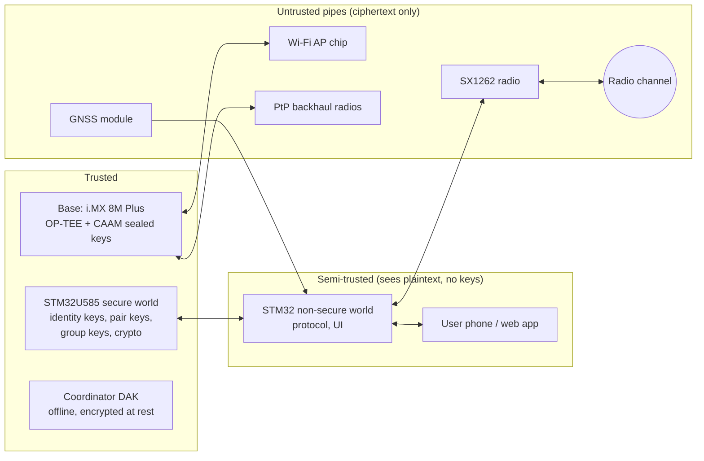

### 9.3 Cryptographic primitives

**[DECIDED] D-006**: Monocypher (single-file C, audited, constant time) on the pucks; equivalent audited Rust crates on the base station.

| Purpose | Primitive | C (puck) | Rust (base, tools) |
|---|---|---|---|
| Signatures | Ed25519 (SHA-512, RFC 8032) | Monocypher `crypto_ed25519_*` (optional module) | `ed25519-dalek` |
| Key agreement | X25519 | Monocypher `crypto_x25519` | `x25519-dalek` |
| AEAD | XChaCha20-Poly1305 (24-byte nonce, 16-byte tag) | Monocypher `crypto_aead_*` | `chacha20poly1305` (`XChaCha20Poly1305`) |
| Hash / MAC / KDF | BLAKE2b | Monocypher `crypto_blake2b*` | `blake2` |
| Randomness | STM32 TRNG, conditioned through BLAKE2b | HAL + own wrapper | OS RNG |
| Storage encryption | AES-256 with the SAES hardware unique key (DHUK) | STM32U5 SAES | CAAM blobs on i.MX |

**KDF** (used everywhere below): `KDF(ikm, label) = BLAKE2b-256(key = ikm, message = "STRATUM v1 " ‖ label)`.

Ed25519 here is the standard SHA-512 variant, not Monocypher's default BLAKE2b EdDSA. This keeps C and Rust implementations interoperable; the cross-implementation test vectors in §10.6 MUST cover it.

### 9.4 Key hierarchy

| Key | Holder | Created | Use |
|---|---|---|---|
| **FSK** — firmware signing key (Ed25519) | Project maintainer, offline | Once | Signs firmware images |
| **DAK** — deployment authority key (Ed25519) | Coordinator tool, offline, passphrase-encrypted | Per organisation | Signs node certificates, revocations, coordinator messages |
| **NMS** — network master secret (32 B) | Every provisioned node (secure world) | Per deployment | Root for all symmetric keys |
| `link_key` = `KDF(NMS, "link")` | All nodes, **including modems** | Derived | L2 MIC (outsider filter only) |
| `group_key(g)` = `KDF(NMS, "group" ‖ g)` | All nodes in group g | Derived | Group AEAD |
| `hop_key` = `KDF(NMS, "hop")` | Base stations | Derived | SDR hop sequence (v2) |
| `wg_key` | Base stations | At provisioning | WireGuard backhaul |
| Node identity (Ed25519 + X25519) | The node, secure world, never exported | At provisioning | Signing, pair keys |
| `pair_key(a,b)` = `KDF(X25519(sk_a, pk_b), "pair" ‖ min(addr_a, addr_b) ‖ max(addr_a, addr_b))` | Both endpoints | On first contact, cached | Unicast AEAD |
| Device storage key | Hardware (DHUK) | Fixed | Encrypting the message store |

**Node certificate** = `Ed25519_sign(DAK, NET_ID ‖ ed_pk ‖ x_pk ‖ role ‖ expiry)`. It is distributed in `ANNOUNCE` (§8.4); nodes MUST ignore announces whose certificate does not verify or has expired.

The link key is deliberately low-value. It reaches the modem pucks in a base station, which only handle L2. Leaking it lets an attacker pass the outsider filter, but not read, forge or replay anything.

### 9.5 Sealing messages

- **Nonce** (24 B) = `SRC (8) ‖ MSG_ID (4) ‖ 12 zero bytes`. Uniqueness comes from `MSG_ID` never repeating per source.
- **Associated data** = the L3 header with the TTL bits of `NCTL` zeroed (TTL changes at every hop), so headers are authenticated end to end.
- **Unicast**: `XChaCha20-Poly1305(pair_key, nonce, AD, plaintext)`.
- **Group**: `XChaCha20-Poly1305(group_key, nonce, AD, plaintext)`, followed by a 64-byte Ed25519 signature by the sender over `AD ‖ ciphertext`. The signature is **REQUIRED** for P0/P1, SOS and coordinator messages, and OPTIONAL otherwise. The UI marks unsigned group messages, which any group member could forge.
- **MSG_ID persistence**: counters are reserved in blocks of 256 written to flash before use. After a reboot the node jumps to the next block, so an ID is never reused even after power loss.
- **Replay window** per source: highest `MSG_ID` seen + a 1024-bit bitmap behind it. Packets older than the window, or past `EXPIRY`, are dropped. The window state is kept for 72 h per source.

### 9.6 Provisioning

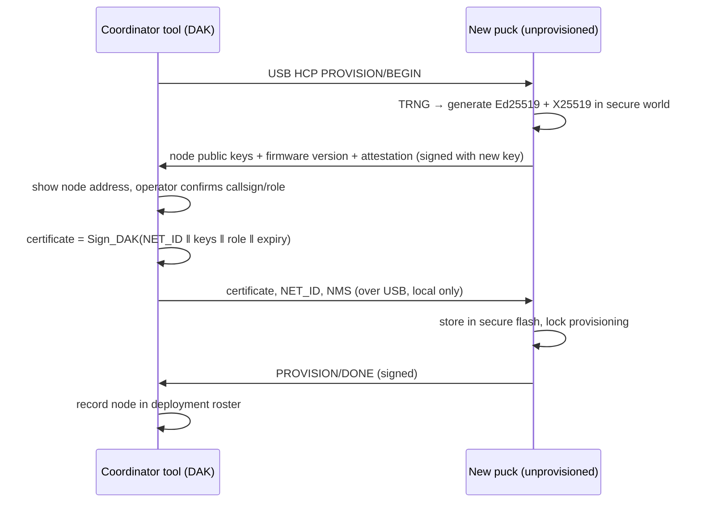

- Provisioning is allowed **only over USB**, never over the air.
- Re-provisioning a puck for a new deployment requires a DAK-signed `PROVISION/RESET` command, or a full wipe (which destroys all keys and the store).
- **Re-key**: when a deployment ends or a revocation needs it, the coordinator rolls a new NMS. Base stations distribute it to provisioned pucks inside pair-key-sealed `MSG`s signed by the DAK.

### 9.7 Revocation

- The coordinator issues a `REVOKE` packet: a list of node addresses plus a sequence number, signed by the DAK, flooded with TTL 15 and re-broadcast by base stations every 10 min for 24 h.
- Nodes drop all traffic from revoked addresses, delete their pair keys and stop relaying for them.
- If a captured puck may have exposed the NMS, the coordinator MUST also roll the NMS (§9.6).

### 9.8 Firmware integrity

- Bootloader: **MCUboot** in the secure world **[PROPOSED]**, with Ed25519 image signatures (FSK) and A/B slots.
- Anti-rollback: security counter in a monotonic location (OTP or write-protected secure flash) **[VERIFY]** RM0456 options.
- Updates: over USB (HCP `DFU`) in v1. Over-the-air updates through a base station are a v2 feature (LoRa bandwidth makes it slow; images are ~300 KB).
- Debug lock: development units use RDP level 1. Fielded units use RDP level 2, or STM32U5 product-state/OEM-key regression **[VERIFY]** in RM0456 which mechanism allows authorised repair.
- Base station: i.MX HAB secure boot **[PROPOSED]**, signed Buildroot image, read-only root filesystem with a separate data partition.

### 9.9 Wi-Fi and backhaul security

- **Civilian Wi-Fi**: open network with a captive portal. No secrets live on this side; the web app treats every civilian post as unverified and rate-limits it per client.
- **Responder access**: a second SSID with WPA3-SAE, password printed on the case, valid for that deployment only.
- **Admin**: no admin interface on Wi-Fi. Administration happens over the coordinator tool (USB or wired Ethernet with a key).
- **Backhaul**: all base ↔ base and base ↔ internet traffic runs inside WireGuard. COTS radios only see encrypted UDP.

### 9.10 Jamming and privacy

- **Jam detection**: the RSSI floor stays > 15 dB above baseline with no decodable packets for 30 s. The node then reports jamming and switches broadcasts to CH-B, and base stations show an alarm.
- **Privacy**: positions are shared only with the group and coordinator. Civilian data on a base station is deleted 30 days after deployment end (configurable retention). Logs never contain decrypted message content.

---

## 10. Software

### 10.1 Components

| Component | Runs on | Language | Name |
|---|---|---|---|
| Puck firmware (normal + modem + relay modes) | STM32U585 | C11 | `firmware/puck` |
| Secure-world services + bootloader | STM32U585 secure world | C11, MCUboot | `firmware/secure` |
| Base supervisor firmware | STM32G4/L4 | C11 | `firmware/supervisor` |
| Base station daemon | i.MX 8M Plus Linux | Rust | `stratumd` |
| Local web app (PWA) | Served by `stratumd`, runs in phone browsers | TypeScript, no framework or a small one (Preact) | `web/` |
| Android app (puck over USB) | Android 10+ | Kotlin | `app/android` |
| Coordinator tool | Linux laptop | Rust | `stratum-ctl` |
| Protocol reference implementation + test vectors | Host | Rust (+ C port) | `protocol/` |
| SDR gateware (v2) | FPGA | VHDL | `gateware/` |

### 10.2 Puck firmware

- **[OPEN] O-003**: RTOS — FreeRTOS (TrustZone port for M33) is the default; Zephyr is the alternative.
- No dynamic allocation after init; fixed pools for packets (64 × 256 B), neighbors (128), routes (256) and the dedup cache (4096).
- Drivers written from datasheets: own SX1262 driver (Semtech's reference driver used only as a cross-check), u-blox UBX parser, MAX17048, charger.
- Storage: littlefs on NOR, every record encrypted with the device storage key.

Tasks and queues:

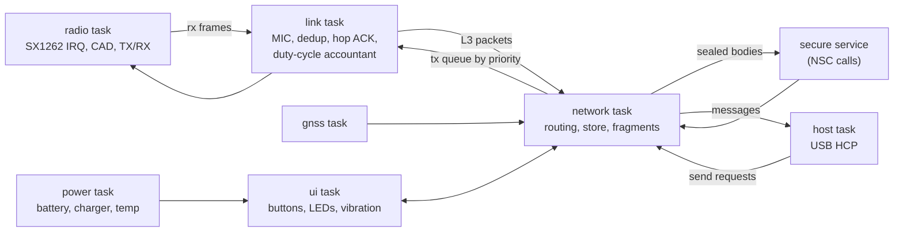

Node state machine:

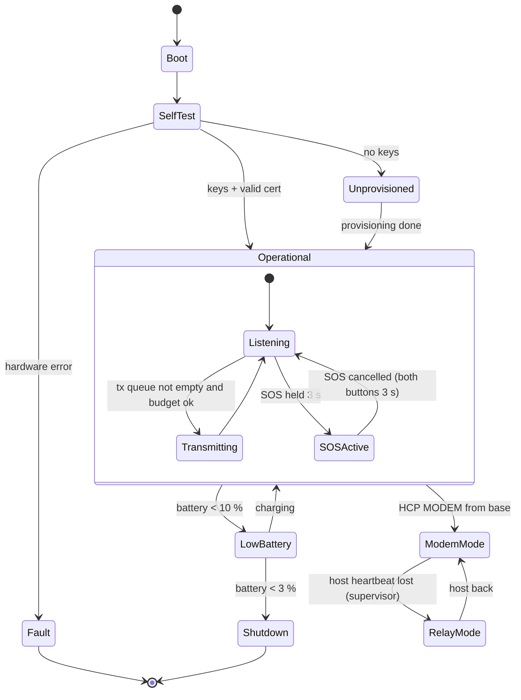

### 10.3 Base station daemon (`stratumd`)

| Module | Role |
|---|---|
| `modem` | Talks HCP to the 1–2 modem pucks; spreads traffic across CH-A/CH-B |
| `net` | Full L3/L4 implementation; route and announce tables; store (SQLite on eMMC) |
| `backhaul` | WireGuard peers to other bases; STRATUM over UDP between bases; table sync |
| `gateway` | Outbound bridge when internet is available: email (SMTP/IMAP) for v1; others later |
| `web` | HTTP server (axum): captive portal, PWA, REST/WebSocket API |
| `supervisor` | Heartbeat to the supervisor MCU; power telemetry |
| `admin` | API for `stratum-ctl` (key-authenticated) |

Web app pages: **Messages** (group and direct, responders only), **Map** (offline tiles of the area, puck positions, SOS markers), **Needs board** (civilian posts: safe / need water / medical …), **Status** (base health, battery, links), **SOS alarms**. Offline map tiles (OpenStreetMap-derived, MBTiles) for the deployment region are loaded before deployment.

### 10.4 Phone access

| Platform | Via puck (USB-C) | Via base Wi-Fi |
|---|---|---|
| Android | Android app (USB host serial) | Browser (PWA) |
| iOS | Not in v1: iOS restricts generic USB serial (O-001) | Browser (PWA) |
| Any laptop | `stratum-ctl` or serial terminal | Browser |

### 10.5 Coordinator tool (`stratum-ctl`)

Commands: `init-deployment` (creates NET_ID, NMS, DAK if needed), `provision`, `roster`, `revoke`, `rekey`, `flash` (signed firmware via USB), `plan` (wraps SPLAT! runs), `export-logs`.

### 10.6 Shared protocol and test vectors

- The Rust crate `protocol/` is the reference implementation of §8–§9. A C port is used on the pucks.
- Test vectors are generated by the reference implementation as JSON (frame bytes, keys, expected outputs) and checked in under `protocol/vectors/`. **This spec stays normative**: a vector disagreeing with the spec is a bug in the vector.
- Vectors cover, at minimum: every frame type, `LMIC`, KDF labels, pair key derivation, sealing (unicast, group, signed), fragmentation/reassembly, replay window edge cases, and duty-cycle accounting.
- CI runs the vectors against both implementations, plus HIL tests on real pucks (§14).

### 10.7 Coding standards

- **C**: C11, `-Wall -Wextra -Werror -Wconversion`; MISRA-C:2012 as guidance; `cppcheck` + `clang-tidy` in CI; every parser fuzzed (libFuzzer/AFL++ on host builds); no recursion, no heap after init.
- **Rust**: stable toolchain, `clippy -D warnings`, `cargo-fuzz` on parsers, `unsafe` only in FFI or hardware access, with justification comments.
- **VHDL**: VHDL-2008, GHDL simulation with self-checking testbenches, formal checks where practical (SymbiYosys).
- Every commit to `main` builds firmware, runs unit tests and vectors.

### 10.8 Tunable parameters (all in one place)

| Parameter | Default | Section |
|---|---|---|
| Primary channel CH-A | 869.525 MHz, BW 125 kHz | §5.2 |
| Default SF | 9 (adaptive 7–12) | §5.3 |
| Puck TX power | +22 dBm | §5.5 |
| Duty-cycle reserve P0/P1 / control / data | 20 % / 15 % / 65 % | §5.4 |
| Beacon interval (base) | 60 s | §8.6 |
| Announce interval | 30 min | §8.4 |
| Position interval | 5 min | §3.1 |
| Mode B → A timeout | 5 min without beacon | §4.2 |
| Hop retries / backoff | 3 / 1, 2, 4 s ± 50 % | §8.7 |
| RREQ ring TTLs | 2, 4, 6 | §8.7 |
| Route lifetime | 10 min unused | §8.7 |
| Dedup cache | 4096 entries, 1 h | §8.7 |
| Flood suppression | skip if heard from ≥ 3 neighbors | §8.7 |
| Expiry P0 / P1 / P2 / P3 | 72 / 24 / 24 / 6 h | §8.8 |
| Fragment limit | 16 (~3 KB) | §8.9 |
| Reassembly timeout | 10 min | §8.9 |
| SOS repeat | 60 s | §8.10 |
| Replay window | 1024 IDs, 72 h | §9.5 |
| Revocation rebroadcast | every 10 min for 24 h | §9.7 |
| Jam detection | floor +15 dB for 30 s | §9.10 |
| Low battery / shutdown | 10 % / 3 % | §10.2 |
| Civilian data retention | 30 days | §9.10 |

---

## 11. Ruggedization and environment

### 11.1 Environmental test targets

Based on MIL-STD-810H; these are **tailored**, informal tests run in-house, not certification.

| Method | Test | Puck | Base station |
|---|---|---|---|
| 501.7 | High temperature | +55 °C operating, +70 °C storage | +60 °C operating (sun on case), +70 °C storage |
| 502.7 | Low temperature | −20 °C operating, −40 °C storage | −30 °C operating, −40 °C storage |
| 503.7 | Temperature shock | −20 ↔ +55 °C, 3 cycles | −30 ↔ +60 °C, 3 cycles |
| 506.6 | Rain | Blowing rain, operating | Blowing rain, deployed with mast cables |
| 507.6 | Humidity | 10 days cyclic | 10 days cyclic |
| 509.7 | Salt fog | 48 h, then function test | 48 h |
| 510.7 | Sand and dust | Blowing dust | Blowing dust, deployed |
| 512.6 | Immersion | 1 m, 30 min (with IP67) | Case closed: 1 m, 30 min |
| 514.8 | Vibration | Ground vehicle profile | Ground vehicle profile, in transport |
| 516.8 | Shock / drop | 26 drops from 1.5 m on concrete (exceeds the 1.22 m transit drop) | 26 drops from 0.5 m, case closed |

### 11.2 Design rules

- No connector exposed without a seal; bulkhead connectors (SMA/TNC on the puck, N-type and sealed circular power/Ethernet on the base).
- Conformal coating on all PCBs; mechanical retention for heavy parts (battery, 21700 holder, SoM).
- Pressure-equalisation vents on every sealed enclosure.
- Batteries: charge window enforced in hardware (charger NTC) **and** firmware (REQ-066); base LiFePO4 uses a heating pad below 0 °C.
- Thermal: puck dissipation < 0.5 W average, no issue. Base: the SoM is conduction-cooled to the case lid, and the case sits in shade or under a light-colored cover in sun.

### 11.3 EMC

- Design to the spirit of **MIL-STD-461G** (CE102, RE102, RS103) and test to **EN 301 489-1/-3** later.
- Practices: solid ground plane, filtered power inputs (common-mode chokes on DC and USB), shielded RF section, harmonic filter after the PA, ESD protection on every external line.
- Pre-scan with a near-field probe kit and a spectrum analyser or SDR before any lab test.

---

## 12. Usability and field operations

### 12.1 Puck controls and LEDs

| Control | Action |
|---|---|
| Multifunction button, short press | Show status on LEDs |
| Multifunction button, hold 2 s | Send "I'm OK" STATUS with position |
| Multifunction button, hold 5 s | Power on / off |
| SOS button (guarded), hold 3 s | Start SOS (vibration confirms) |
| Both buttons, hold 3 s | Cancel SOS |

| LED | Pattern | Meaning |
|---|---|---|
| Power | Green slow blink / amber / red | Battery > 50 % / 10–50 % / < 10 % |
| Link | Off / amber blink / green blink / green solid | No neighbors / peers only (mode A) / base in range (mode B) / gateway reachable (mode C) |
| Message | Blue blink | Unread message (on phone or waiting) |
| All | Red fast blink | SOS active |
| All | Red solid | Fault — see the phone app or reboot |

### 12.2 Base station deployment

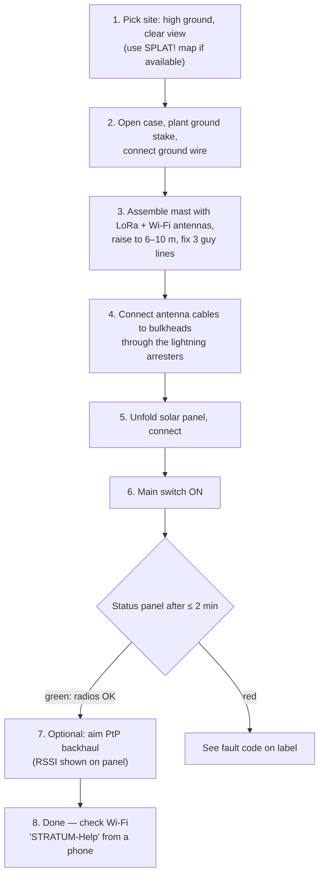

Target: ≤ 10 min with 2 people (REQ-082). The checklist is printed inside the case lid.

### 12.3 Puck quick start (label on the unit)

1. Hold the round button 5 s — LEDs light up.
2. Plug in your phone (Android app) or just carry it — it relays for others automatically.
3. Emergency: lift the cover, hold SOS 3 s.
4. Charge with any USB-C charger, between 0 and 45 °C.

---

## 13. Regulatory

Not legal advice. Check with ARCEP / ANFR and a test lab before any public deployment or sale.

| Topic | Reference | Applies to |
|---|---|---|
| Radio equipment directive | RED 2014/53/EU | All radio products placed on the EU market |
| SRD 868 MHz | ERC/REC 70-03 Annex 1; ETSI EN 300 220-1/-2 | Puck, base LoRa |
| 2.4 GHz wideband | ETSI EN 300 328 | Base Wi-Fi, SDR v2 at 2.4 GHz |
| 5 GHz RLAN | ETSI EN 301 893 (DFS, TPC) | Wi-Fi 5 GHz, PtP backhaul |
| 60 GHz | ETSI EN 302 567 | Short PtP links |
| EMC for radio | ETSI EN 301 489-1 / -3 / -17 | All |
| Electrical safety | EN 62368-1 | All |
| RF exposure | EN 62479 / EN 50663 | Puck (body-worn) |
| Lithium battery transport | UN 38.3 | Puck batteries, base LiFePO4 |
| Amateur radio | HAREC license (ANFR exam in France) | Future HF extension only |

Firmware enforces duty cycle and power per sub-band (REQ-100, REQ-101). Prototypes used for development are not "placed on the market", but they still MUST respect the band rules when transmitting.

---

## 14. Testing and validation

### 14.1 Levels

| Level | What | Where |
|---|---|---|
| Unit | Parsers, crypto wrappers, routing logic | Host, CI |
| Vector | C ↔ Rust interop (§10.6) | Host, CI |
| Fuzz | Every frame/packet/HCP parser | Host, nightly |
| HIL | Pucks on the bench, RF through step attenuators in a shield box | Lab rig |
| Network sim | 50–500 virtual nodes running the real protocol code over a simulated channel | Host |
| Field | Real terrain, range and multi-hop | Outdoors |
| Environmental | §11.1 tests | Freezer, oven, drop rig, water tank |
| Security | Replay, injection, rogue base, fuzz over the air | SDR + spare pucks |

### 14.2 Test list

| ID | Test | Pass criterion | Req |
|---|---|---|---|
| T-001 | Two pucks, direct text, 1 km open terrain | 100/100 delivered | REQ-001 |
| T-002 | 5-puck chain, 4 hops | ≥ 90 % delivered < 30 s | REQ-002, REQ-023 |
| T-003 | Store-and-forward: walking puck joins two isolated groups | 100 % delivered after contact | REQ-003 |
| T-004 | SOS over 3 hops to base | ≥ 95 % < 60 s | REQ-006, REQ-022 |
| T-005 | Range puck ↔ puck, open | ≥ 2 km at ≥ 90 % PDR | REQ-020 |
| T-006 | Range puck ↔ base (8 m mast) | ≥ 8 km at ≥ 90 % PDR | REQ-021 |
| T-007 | Duty cycle: 1 h saturation | Measured airtime ≤ limit per sub-band (SDR capture) | REQ-100, REQ-101 |
| T-008 | Battery life, typical profile | ≥ 72 h | REQ-025 |
| T-009 | Base autonomy, no solar | ≥ 36 h | REQ-026 |
| T-010 | Replay of a captured SOS | Dropped by all nodes | REQ-042 |
| T-011 | Injection from an unprovisioned SX1262 | Dropped at L2 | REQ-041 |
| T-012 | Rogue base with a self-signed beacon | Ignored | §9.1 |
| T-013 | Revoked puck sends traffic | Dropped network-wide within 10 min | REQ-045 |
| T-014 | Unsigned / downgraded firmware | Refused by bootloader | REQ-044 |
| T-015 | SWD access on a fielded unit | No access | REQ-047 |
| T-016 | Base deployment by 2 untrained people with the checklist | ≤ 10 min | REQ-082 |
| T-017 | Civilian phone joins Wi-Fi, posts a need | Works in a default browser, no install | REQ-083 |
| T-018 | Linux crash on the base | LoRa relay continues; SoM recovers | §4.3 |
| T-019 | Drop test, 26 drops 1.5 m | Fully functional, seal intact | REQ-061 |
| T-020 | Immersion 1 m / 30 min | No water ingress, functional | REQ-060 |
| T-021 | Cold operation −20 °C, 12 h | Functional; charging refused below 0 °C | REQ-062, REQ-066 |
| T-022 | Network sim: 300 nodes, 3 bases | No routing loops; control traffic < 15 % airtime | §5.4, §8.7 |

### 14.3 Field test protocol

1. Log everything: each node writes RX/TX metadata (time, RSSI, SNR, SF, hop, `MSG_ID`) to its store, exported with `stratum-ctl export-logs`.
2. A standard route: one open, one forest, one urban, and one in "rubble-like" conditions (inside concrete buildings, basements).
3. Results go into a short report per campaign; any number that changes a target updates this spec.

---

## 15. Roadmap

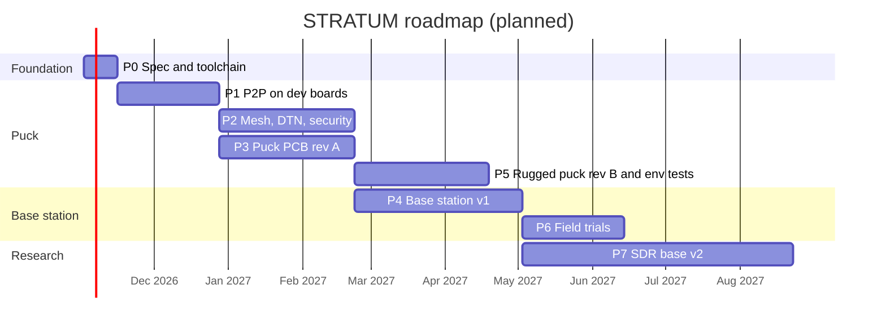

| Phase | Deliverables | Exit criteria |
|---|---|---|
| **P0** Spec & toolchain | This spec v0.2; repo skeleton; CI; toolchains on Arch | Firmware "hello" builds and flashes; CI green |
| **P1** P2P on dev boards | STM32U585 discovery kit + SX1262 module; SX1262 driver; L2 + duty-cycle accountant; plain text over HCP | T-001 passes with 2 units |
| **P2** Mesh, DTN, security | L3 routing, store-and-forward, fragmentation, full L4 crypto, provisioning, `stratum-ctl` basics, network simulator | T-002, T-003, T-010, T-011, T-022 pass |
| **P3** Puck PCB rev A | KiCad schematic + layout, 5 units assembled, COTS IP67 box | Rev A matches dev-board behavior; T-008 measured |
| **P4** Base station v1 | Case integration, `stratumd`, web app, supervisor, 2 units | T-004, T-006, T-009, T-016–T-018 pass |
| **P5** Rugged puck rev B | Custom enclosure, environmental campaign | T-019–T-021 pass |
| **P6** Field trials | 10 pucks + 2 bases, multi-site campaign | All M requirements verified |
| **P7** SDR base v2 | Platform choice (O-004), first VHDL waveform, link test | STRATUM frames carried over the custom PHY |

Phase 1 dev hardware: 3× **NUCLEO-U545RE-Q** + 3× **Waveshare Core1262-868M** (SX1262) wired over SPI, with 868 MHz antennas. Full list in [§16.0](#160-phase-1-development-kit-sourced-2026-10-28). Same STM32U5 family as the puck, so firmware ports directly.

---

## 16. Bill of materials (estimates)

### 16.0 Phase 1 development kit (sourced 2026-10-28)

Three dev-board nodes: two pucks plus one sniffer/logger (later the first relay for multi-hop tests). Prices as listed on 2026-10-28; shipping not included.

| Item | Part / ref | Supplier | Qty | Unit | Total |
|---|---|---|---|---|---|
| MCU board | NUCLEO-U545RE-Q (Mouser `511-NUCLEO-U545RE-Q`) | [Mouser FR](https://www.mouser.fr/en/ProductDetail/STMicroelectronics/NUCLEO-U545RE-Q?qs=mELouGlnn3cp3Tn45zRmFA%3D%3D) | 3 | €22.52 excl. VAT (~€27 incl.) | ~€81 |
| LoRa module | Waveshare Core1262-868M (SX1262, TCXO) | [RobotShop EU](https://eu.robotshop.com/fr/products/module-lora-core1262-868m-sx1262-anti-interference-bande-eu868) | 3 | €8 | €24 |
| Antenna | 868 MHz ±3 MHz, 2 dBi, SMA male right-angle, VSWR ≤ 1.5 (RF Konnect MINI-ANT-868-ANGLE-881) | [Passion Radio](https://www.passion-radio.fr/868/868-angle-881.html) | 3 | €6.70 excl. VAT | ~€24 |
| Pigtail | U.FL (IPEX-1/MHF1) female → SMA female, 10 cm (Getic P-UF-SF-10) | [Getic](https://www.getic.fr/product/pigtail-u-fl-female-sma-female-10cm) | 5 (2 spares) | €2.98 incl. VAT | ~€15 |
| **Total** | | | | | **~€144 + shipping** |

Notes for this kit:

- **Core1262 driver init**: the TCXO is powered through DIO3 → send `SetDio3AsTcxoCtrl` (1.8 V reported by users [VERIFY] against the Waveshare schematic) before calibration; the RF switch is driven by DIO2 → `SetDio2AsRfSwitchCtrl(1)`.
- Check the Core1262 **pin pitch** before wiring to the Nucleo Arduino headers; plan a small perfboard adapter if it is not 2.54 mm.
- Pigtails must be **SMA**, not RP-SMA (center hole on the female connector). Fix the SMA end to the adapter board: the u.FL connector is rated for ~30 mating cycles and must not carry the antenna's weight.
- **Never transmit without an antenna** at +22 dBm.
- Keep antennas vertical and parallel during range tests (polarisation mismatch costs 10–20 dB).
- Mouser ships free to France above €75 on most orders: check the basket; a 4th Nucleo can cost less than the shipping fee.
- Recommended add-on: cheap 8-channel logic analyser (sigrok/PulseView) for SPI, BUSY and DIO1, ~€10–15.

Later phases below are prototype quantities (1–10 units), EUR, excluding VAT. **All prices are rough estimates [VERIFY]**.

### 16.1 Puck rev A

| Item | Est. cost |
|---|---|
| STM32U585 | 10–14 |
| SX1262 + TCXO + RF switch + filter | 8–12 |
| GNSS module + antenna | 15–20 |
| 16 MB NOR flash | 2–3 |
| Charger, fuel gauge, buck-boost, USB-C, ESD | 8–12 |
| 21700 Li-ion cell + holder | 8–12 |
| PCB (4-layer, small batch) + assembly | 15–30 |
| 868 MHz antenna + bulkhead connector | 6–12 |
| Enclosure (COTS IP67 + gaskets + vent) | 12–25 |
| **Total per puck** | **~85–140** |

### 16.2 Base station v1

| Item | Est. cost |
|---|---|
| i.MX 8M Plus industrial SoM + carrier | 200–350 |
| 2× puck boards (modem config) | 100–160 |
| Wi-Fi module + antenna | 40–80 |
| Supervisor MCU board | 20–40 |
| LiFePO4 12.8 V 50 Ah with BMS + heating pad | 220–330 |
| Solar panel 200 W folding + MPPT | 200–300 |
| Rugged case + bulkheads + arresters | 200–350 |
| Telescopic mast 10 m + guy kit | 120–250 |
| Collinear 868 MHz antennas ×2 + coax | 80–150 |
| COTS PtP backhaul pair (optional) | 150–300 |
| Cabling, connectors, misc | 80–150 |
| **Total per base station** | **~1400–2400** |

### 16.3 Lab equipment (one-off)

SDR for spectrum and duty-cycle checks, RF shield box, step attenuators, RF power meter or spectrum analyser (used), bench supply, near-field probes. Budget ~500–1500.

---

## 17. Risks

| ID | Risk | Likelihood | Impact | Mitigation |
|---|---|---|---|---|
| R-001 | LoRa capacity too low for a busy deployment (duty cycle, airtime) | High | High | Priorities and reserves; two modems per base; SF adaptation; heavy traffic routed to Wi-Fi/backhaul; measure in network sim early (T-022) |
| R-002 | Ground-level range below target in cluttered terrain | Medium | High | More bases, masts; SPLAT! planning; field data early (P1) |
| R-003 | Protocol complexity delays everything | Medium | High | Strict phase gates; simulator; reference implementation in Rust first |
| R-004 | Crypto implementation error | Medium | Critical | Audited libraries only; cross-implementation vectors; fuzzing; no custom primitives |
| R-005 | iOS cannot use pucks over USB | High | Medium | Base-station PWA for iOS; BLE puck variant later (O-001) |
| R-006 | Regulatory mistakes (power, duty cycle) | Low | High | Firmware-enforced limits; SDR verification (T-007); check current ERC 70-03 |
| R-007 | Battery safety in heat or cold | Low | Critical | JEITA charging, NTC, firmware cutoffs, LiFePO4 for the base |
| R-008 | Enclosure sealing failures | Medium | Medium | COTS IP67 enclosures for rev A; immersion test every build |
| R-009 | Supply chain (SoM, STM32 availability) | Medium | Medium | Pin-compatible alternates (STM32U5 family); stock for the trial fleet |
| R-010 | Scope creep into the SDR before v1 works | High | Medium | P7 starts only after P4 |
| R-011 | Captured device exposes NMS | Medium | High | Re-key procedure (§9.6); short deployment lifetimes |

---

## 18. Decision log and open questions

### 18.1 Decisions

| ID | Date | Decision | Rationale |
|---|---|---|---|
| D-001 | 2026-10-28 | No ESP32 anywhere in the design | Owner's trust concerns about closed firmware; STM32 + FPGA expertise |
| D-002 | 2026-10-28 | Radio, GNSS and Wi-Fi chips are untrusted pipes; keys and crypto stay in the STM32 secure world | A compromised modem must not be able to read or forge traffic |
| D-003 | 2026-10-28 | Puck = STM32U585 + SX1262 (not STM32WL) | WL lacks USB; host/modem split keeps the radio outside the trust boundary |
| D-004 | 2026-10-28 | Own protocol, Reticulum-inspired | Reticulum reference implementation is Python and does not fit the MCU; full auditability |
| D-005 | 2026-10-28 | C11 for firmware, Rust for base and tools, VHDL for gateware | Owner's expertise; memory safety where code size allows |
| D-006 | 2026-10-28 | Monocypher (C) + RustCrypto/dalek crates; XChaCha20-Poly1305, Ed25519, X25519, BLAKE2b | Audited, small, constant time, interoperable |
| D-007 | 2026-10-28 | Primary channel 869.525 MHz (10 %, 500 mW sub-band) | Only EU SRD sub-band with both high power and high duty cycle |
| D-008 | 2026-10-28 | Hybrid P2P + base station topology, one protocol for both | Works without infrastructure; better with it |

### 18.2 Open questions

| ID | Question | Options | Needed by |
|---|---|---|---|
| O-001 | Phone link for iOS | BLE via STM32WBA companion chip / Wi-Fi-only (PWA) | P5 |
| O-002 | Final project name | STRATUM (working) / other | Before any public repo |
| O-003 | Puck RTOS | FreeRTOS (TrustZone port) / Zephyr | Start of P1 |
| O-004 | SDR platform | Zynq-7020 + AD9363 / ECP5 + AT86RF215 | Start of P7 |
| O-005 | External secure element in the puck | None (TrustZone + SAES) / ST SAFE-A110 class | P3 |
| O-006 | Application payload encoding | Own TLV / CBOR | P2 |
| O-007 | License | Open hardware + open source (e.g. CERN-OHL-S + GPL/Apache) / closed | Before any public repo |
| O-008 | Voice clips over LoRa | Codec2 1200 bps, P3 class / not supported | After P6 |
| O-009 | Duty-cycled receive on the puck | Continuous RX (v1) / preamble sniffing with wake-up | After P2 |
| O-010 | Tethered drone or aerostat relay | Not in scope / research add-on | After P6 |
| O-011 | Puck MCU: keep STM32U585 or move to STM32U545 (cheaper, smaller) | U585 / U545 — check USB device, SAES/PKA, flash for 2 image slots + stack | P3 |

---

## 19. Repository layout and toolchain

### 19.1 Layout

```
stratum/
├── SPEC.md                  ← this document (normative)
├── firmware/
│   ├── puck/                C11, puck firmware (normal / modem / relay modes)
│   ├── secure/              secure-world services, MCUboot config
│   └── supervisor/          base station supervisor MCU
├── protocol/
│   ├── rust/                reference implementation (crate)
│   ├── c/                   C port used by firmware
│   └── vectors/             generated test vectors (JSON)
├── basestation/
│   ├── stratumd/            Rust daemon
│   └── image/               Buildroot config, overlays
├── web/                     PWA served by stratumd
├── app/android/             Kotlin app (puck over USB)
├── tools/
│   ├── stratum-ctl/         coordinator CLI (Rust)
│   └── netsim/              network simulator
├── hardware/
│   ├── puck/                KiCad project
│   ├── base/                KiCad (supervisor, carrier, power)
│   └── mechanical/          enclosure CAD
├── gateware/                VHDL (SDR v2)
└── test/
    ├── hil/                 bench rig scripts
    └── field/               field test reports
```

### 19.2 Toolchain (Arch Linux)

| Purpose | Tools |
|---|---|
| Firmware build | `arm-none-eabi-gcc`, CMake, Ninja |
| Flash and debug | OpenOCD or probe-rs, STM32CubeProgrammer (option bytes, TrustZone setup), ST-LINK V3 |
| Rust | rustup (stable), cargo-fuzz, clippy |
| Static analysis / fuzzing | cppcheck, clang-tidy, AFL++ / libFuzzer |
| Hardware | KiCad, FreeCAD |
| FPGA | GHDL + Yosys + nextpnr-ecp5 (option B) or Vivado (option A), SymbiYosys |
| RF planning | SPLAT! with SRTM data |
| RF test | SDR + GNU Radio / inspectrum for airtime and spectrum checks |
| Base image | Buildroot |
| Android | Android Studio / Gradle |

---

## 20. References

Datasheets and standards to download and keep with the project (the only external documents):

| Document | Covers |
|---|---|
| Semtech SX1261/2 datasheet | Radio, sensitivity, current, commands |
| Semtech AN1200.13 "LoRa Modem Designer's Guide" | Airtime formula, link budget |
| Semtech AN1200.22 / CAD application notes | Channel Activity Detection |
| ST RM0456 (STM32U5 reference manual) + STM32U585 datasheet | MCU, TrustZone, SAES/DHUK, RDP/product states |
| ST UM2839 / B-U585I-IOT02A user manual | Phase 1 dev board |
| u-blox MAX-M10S datasheet + UBX protocol spec | GNSS |
| TI BQ2561x, TPS63802; Analog Devices MAX17048 datasheets | Power |
| NXP i.MX 8M Plus reference manual + HAB/CAAM docs | Base compute, secure boot |
| ADI AD9363 / Microchip AT86RF215 datasheets | SDR v2 options |
| ERC Recommendation 70-03 (current edition) | EU SRD band rules |
| ETSI EN 300 220-1/-2, EN 300 328, EN 301 893, EN 302 567, EN 301 489 | Radio and EMC standards |
| MIL-STD-810H, MIL-STD-461G | Environmental and EMC test methods |
| RFC 8032 (EdDSA), RFC 7748 (X25519), RFC 7693 (BLAKE2), draft XChaCha20-Poly1305 | Crypto |
| Monocypher manual; MCUboot documentation | Crypto library, bootloader |
| Reticulum manual | Design inspiration (not a dependency) |
| SPLAT! documentation | Coverage planning |

---

## 21. Glossary

| Term | Meaning |
|---|---|
| AEAD | Authenticated encryption with associated data |
| Announce | Broadcast that publishes a node's public keys and certificate |
| Base station | Mast-mounted STRATUM node with Wi-Fi AP, local services, solar |
| CAD | Channel Activity Detection (LoRa listen-before-talk) |
| Custody | Responsibility for a stored packet until it is passed on or expires |
| DAK | Deployment authority key — signs certificates and revocations |
| DHUK | Derived hardware unique key (STM32U5 SAES) |
| DTN | Delay/disruption-tolerant networking |
| Duty cycle | Fraction of time a transmitter may be on, per regulation |
| ETX | Expected transmission count — link quality metric |
| FHSS | Frequency-hopping spread spectrum |
| FSK | Firmware signing key |
| Gateway | Base station role with internet access |
| HCP | Host control protocol (puck ↔ phone/base over USB) |
| LMIC | Link message integrity code (L2 outsider filter) |
| Modem mode | Puck firmware mode where a base station drives it as a radio |
| NMS | Network master secret, root of all deployment symmetric keys |
| NVIS | Near-vertical incidence skywave (HF propagation) |
| PDR | Packet delivery ratio |
| Puck | Handheld STRATUM node |
| PWA | Progressive web app (served by the base station) |
| RDP | STM32 readout protection level |
| SF | LoRa spreading factor |
| SRD | Short-range device (EU regulatory category) |
| TTL | Remaining hop count |

---

## 22. Changelog

| Version | Date | Change |
|---|---|---|
| 0.1 | 2026-10-28 | First complete draft: architecture, RF, hardware, protocol, security, software, tests, roadmap |
| 0.1.1 | 2026-10-28 | Phase 1 dev kit sourced and added to the BOM (§16.0); Phase 1 hardware changed to NUCLEO-U545RE-Q + Core1262-868M; added O-011 |
